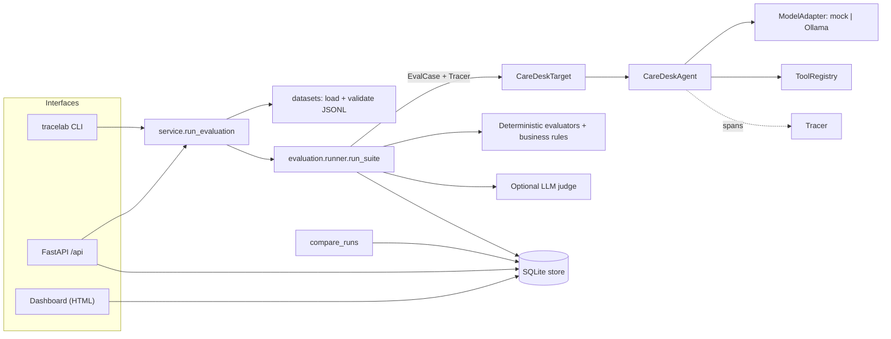

# TraceLab

**An evaluation, tracing, and regression-testing platform for reliable LLM applications.**

TraceLab runs a versioned dataset of test cases against an LLM application, records a
step-level trace of every execution (model calls, tool calls, validation, errors, latency,
provider-reported token usage), scores each case with deterministic checks plus an optional,
separately reported LLM judge, stores everything in SQLite, and compares runs to show what
regressed and what was fixed.

It works fully offline with a deterministic mock model. No API key, paid service, internet
connection or Ollama is needed for the core workflow, the test suite or CI. A local Ollama
model can optionally be used for both the application and the judge.

---

## Contents

1. [Problem statement](#problem-statement)
2. [Main features](#main-features)
3. [Architecture](#architecture)
4. [Repository structure](#repository-structure)
5. [Prerequisites and installation](#prerequisites-and-installation)
6. [Configuration](#configuration)
7. [Running TraceLab](#running-tracelab)
8. [Running the tests](#running-the-tests)
9. [Running an evaluation](#running-an-evaluation)
10. [Inspecting a trace](#inspecting-a-trace)
11. [Demonstrating a regression and its fix](#demonstrating-a-regression-and-its-fix)
12. [Optional: local models with Ollama](#optional-local-models-with-ollama)
13. [Example outputs](#example-outputs)
14. [Evaluation methodology](#evaluation-methodology)
15. [Known limitations](#known-limitations)
16. [Security considerations](#security-considerations)
17. [Future improvements](#future-improvements)

---

## Problem statement

LLM applications fail in ways that ordinary unit tests do not catch: the model returns
malformed JSON, invents a tool, calls a real tool with `null` arguments, or answers fluently
while a side effect has already gone wrong. When a test fails, a developer needs to know
*which step* was responsible: the model, the parser, a guard, or a tool.

TraceLab gives that workflow a concrete shape:

1. Run an evaluation suite against the application; every case gets a run ID and a trace ID.
2. Deterministic evaluators compare actual behaviour with expected behaviour.
3. Open a failed case and read its trace step by step to find the faulty step.
4. Write a regression test, fix the code, run the suite again.
5. Compare the two runs: what was fixed, what still fails, and whether anything regressed.

The application under test is **CareDesk**, a small *fictional* preventive-care booking
assistant (packages, appointments, policies) built on synthetic data. It exists only as a
realistic system under test. It does not give medical advice and processes no real data.

## Main features

All of these are implemented and covered by the automated tests.


| Area                  | What exists                                                                                                                                                                                                                                                                                                                                      |
| --------------------- | ------------------------------------------------------------------------------------------------------------------------------------------------------------------------------------------------------------------------------------------------------------------------------------------------------------------------------------------------ |
| Demo application      | CareDesk agent: input policy guard -> model plan (structured JSON) -> plan validation -> tool-argument validation -> tool execution -> model-written reply. Asks for missing information instead of proceeding. Controlled errors for invalid model output, unknown tools, tool failures and timeouts.                                           |
| Model adapters        | One`ModelAdapter` protocol. Deterministic offline **mock** with injectable failures (malformed JSON, wrong schema, fenced JSON, hallucinated tool, empty output, timeout, timeout-once, unavailable). Optional **Ollama** adapter (structured output via JSON schema, configurable model, graceful errors, provider-reported token counts only). |
| Tracing               | Spans with trace/span/parent IDs, start order, UTC timestamps, monotonic durations (ms), status (`ok`/`error`/`cancelled`), sanitized attributes, error type/code/message, token usage when the provider reports it, and one span per model retry attempt.                                                                                       |
| Evaluation            | Deterministic evaluators: output schema, expected action, missing fields, required and forbidden tools (read from the trace), field values, answer contains / not contains, error code, named business rules. Optional LLM judge with an explicit 1-5 rubric, reported separately and never part of pass/fail.                                   |
| Datasets              | JSONL with an explicit, strict schema (`schema_version`, `case_id`, input, expected behaviour, tags, severity, failure simulation, judge rubric). All problems reported with line numbers; nothing is skipped silently. SHA-256 of the dataset stored with each run. Committed JSON Schema kept in sync by a test.                               |
| Persistence           | SQLite: runs (with full config snapshot), traces, spans, case results, evaluations.                                                                                                                                                                                                                                                              |
| Regression comparison | Newly failed, newly passed, still failing, passed in both, skipped, added/removed cases; per-evaluator changes; config diff between runs; absolute metrics and deltas, with missing metrics reported as unavailable; a regression gate that also fails on incomplete runs or lost coverage.                                                      |
| Interfaces            | `tracelab` CLI, FastAPI JSON API (OpenAPI at `/docs`), server-rendered dashboard.                                                                                                                                                                                                                                                                |
| Regression demo       | A controlled fault reproduces a realistic bug without editing tracked code;`tracelab demo-regression` walks baseline -> bug -> diagnosis -> fix.                                                                                                                                                                                                 |
| CI                    | GitHub Actions on Python 3.11/3.12/3.13: ruff, dataset validation, pytest, mock-model evaluation, regression demo, ignore-rule check.                                                                                                                                                                                                            |

## Architecture



**How one evaluation case flows through the system**

1. `tracelab run` (or `POST /api/runs`) loads a run config from `configs/`, builds the target,
   and validates the whole dataset up front. An invalid dataset stops the run before it starts.
2. `run_suite` creates a run record (config snapshot, dataset path and SHA-256) and executes
   cases concurrently, bounded by `concurrency`, each under a harness timeout.
3. For each case the target builds a `CareDeskAgent` (the mock adapter is rebuilt per case so
   each case can inject its own failure) and calls `handle()` with a fresh `Tracer`.
4. The agent records spans: `agent.handle` -> `policy.screen_input` -> `plan`
   (`llm.generate`, `parse.plan`) -> `validate.tool_call` -> `tool.<name>` -> `compose`
   (`llm.generate`, `parse.answer`).
5. Deterministic evaluators read the structured output **and the trace** (tool calls come from
   tool spans, so an application cannot hide a call it made). The judge runs only if enabled
   and the case has a rubric.
6. The case result, trace, spans and evaluations are written in one SQLite transaction as soon
   as the case finishes, so partial runs remain inspectable.
7. The dashboard, API and CLI read the same store; `compare_runs` diffs two stored runs.

**Design choices**

- **Engine and application are separate.** `tracelab.evaluation` only knows the `Target`
  protocol and a small output convention (`action`, `answer`, `missing_fields`, `error.code`).
  CareDesk lives in `tracelab.demo_app` and registers its own business rules.
- **Deterministic guards around the model.** Medical-advice screening and required-argument
  checks never depend on the model behaving well.
- **Async where it helps.** Model calls are I/O-bound, so cases run concurrently with
  `asyncio`; timeouts use `asyncio.wait_for` / `asyncio.timeout`. SQLite access is
  synchronous and is moved off the event loop with `asyncio.to_thread`; read-only API
  endpoints are plain `def` so FastAPI runs them in its threadpool.
- **Retries are narrow.** Only model *timeouts* are retried (configurable attempts). Connection
  refusals and missing models are not retried, and tools are never retried automatically
  (`book_appointment` is marked non-idempotent).
- **Dashboard without a frontend build.** Server-rendered Jinja2 pages in the same FastAPI
  process; no Node toolchain, no extra service.

## Repository structure

```text
.
|-- configs/
|   |-- baseline.json          # mock model, prompt v1, simulated judge (used by CI)
|   `-- ollama.json            # local Ollama model for app and judge (optional)
|-- datasets/
|   |-- caredesk-v1.jsonl      # 20 evaluation cases
|   |-- examples/invalid-records.jsonl   # deliberately broken records (tested)
|   `-- schema/eval-case.v1.schema.json  # JSON Schema export (kept in sync by a test)
|-- src/tracelab/
|   |-- adapters/              # ModelAdapter protocol, mock, Ollama, factory
|   |-- tracing/               # Tracer/Span, sanitization, text rendering
|   |-- datasets/              # record schema and validating loader
|   |-- evaluation/            # evaluators, business-rule registry, judge, runner, compare
|   |-- demo_app/              # CareDesk: agent, tools, guards, prompts, faults, target
|   |-- storage/store.py       # SQLite persistence
|   |-- api/                   # FastAPI app, JSON routes, dashboard + templates
|   |-- service.py             # wiring shared by CLI and API
|   |-- config.py              # environment settings and run configs
|   `-- cli.py                 # `tracelab` command
|-- tests/                     # pytest suite (no network, no Ollama needed)
|-- .github/workflows/ci.yml
|-- pyproject.toml
|-- requirements-lock.txt      # exact versions verified by the test suite
```

## Prerequisites and installation

- Python **3.11 or newer** (verified locally on 3.11.15, 3.13.12 and 3.14.5 on Windows 11).
- Git.
- Optional: [Ollama](https://ollama.com) with a model you have already pulled.

```bash
git clone <your-fork-url> tracelab && cd tracelab
python -m venv .venv
source .venv/bin/activate            # Windows PowerShell: .venv\Scripts\Activate.ps1
pip install -c requirements-lock.txt -e ".[dev]"
```

`requirements-lock.txt` is used as a *constraints* file: it pins the exact versions the test
suite was run with while `pyproject.toml` keeps the declared minimum versions. Runtime
dependencies are FastAPI, Uvicorn, Pydantic, HTTPX and Jinja2 (`opentelemetry-api` in the lock
file is pulled in by FastAPI; TraceLab does not use it). Dev tools are pytest and ruff.

## Configuration

TraceLab needs no secrets. Environment variables (all optional, see `.env.example`;
TraceLab reads the real environment and does not load `.env` files):


| Variable                                         | Default                  | Purpose                                              |
| ------------------------------------------------ | ------------------------ | ---------------------------------------------------- |
| `TRACELAB_DB_PATH`                               | `.tracelab/tracelab.db`  | SQLite database                                      |
| `TRACELAB_OLLAMA_BASE_URL`                       | `http://127.0.0.1:11434` | Ollama server                                        |
| `TRACELAB_OLLAMA_MODEL`                          | `llama3`                 | model used when a config leaves`adapter.model` empty |
| `TRACELAB_PROJECT_ROOT`                          | current directory        | base for relative paths                              |
| `TRACELAB_CONFIGS_DIR` / `TRACELAB_DATASETS_DIR` | `configs` / `datasets`   | config and dataset locations                         |

A **run config** (`configs/*.json`) chooses the dataset, model adapter, prompt version, retry
attempts, judge, concurrency and timeouts. The full config is stored with every run, so a
change in prompt or model is always traceable to the runs that used it.

## Running TraceLab

```bash
tracelab serve                     # API + dashboard on http://127.0.0.1:8000
```


| Page / endpoint                                                                          | Purpose                                                                                                                |
| ---------------------------------------------------------------------------------------- | ---------------------------------------------------------------------------------------------------------------------- |
| `/`                                                                                      | runs with pass/fail/error/skip counts, injected fault, judge mean; recent ad-hoc traces                                |
| `/runs/{run_id}`                                                                         | summary, per-evaluator results, judge, latency, tokens, case list (`?status=failing`)                                  |
| `/runs/{run_id}/cases/{case_id}`                                                         | evaluations, input/expected/actual, full step-by-step trace                                                            |
| `/compare?base=..&head=..`                                                               | regression comparison                                                                                                  |
| `GET /api/health`, `GET /api/runs`, `POST /api/runs`                                     | health, list runs, start a run`{"config": "baseline", "inject_fault": null, "case_ids": null, "judge": null}`          |
| `GET /api/runs/{id}`, `GET /api/runs/{id}/cases/{case_id}`, `GET /api/traces/{trace_id}` | stored results and traces                                                                                              |
| `GET /api/compare?base=..&head=..`                                                       | comparison as JSON                                                                                                     |
| `POST /api/caredesk/ask`                                                                 | call the demo app directly`{"message": "...", "context": {"member_id": "M-1001"}}`; every request is traced and stored |

Interactive OpenAPI docs are at `/docs` (the Swagger UI assets load from a CDN; offline, use
`/openapi.json`).

## Running the tests

```bash
pytest                             # 209 tests; the live Ollama test is skipped by default
ruff check src tests && ruff format --check src tests
```

The suite needs no network, model or API key. It covers adapters (Ollama via
`httpx.MockTransport`), tracing (nesting, errors, cancellation, redaction), dataset validation,
tools and guards, every agent failure path, evaluators and the judge, the runner (harness
errors, timeouts, skips, concurrency), persistence, comparison, API/dashboard consistency and
HTML escaping, and the CLI including exit codes.

## Running an evaluation

```bash
tracelab validate                  # schema + application checks for the configured dataset
tracelab run                       # configs/baseline.json: mock model, offline
tracelab run --case book-missing-date-001 --no-judge
tracelab run --prompt-version v2   # override parts of the config; stored with the run
tracelab runs                      # list runs
```

`tracelab run` exits with `0` when every executed case passes, `1` when any case fails or
errors (or when nothing was executed because every case was skipped), and `2` for usage or
configuration errors (unknown config, missing dataset file, unknown fault or evaluator name), so
it can gate CI. `tracelab validate` exits `1` for an invalid dataset:

```bash
tracelab validate datasets/examples/invalid-records.jsonl
```

## Inspecting a trace

```bash
tracelab show latest --failed                     # failing cases + evaluator explanations
tracelab trace latest book-missing-date-001       # step-by-step trace with attributes
tracelab ask "Please book the Heart Health Check" --context member_id=M-1001 --attrs
```

Or open the case page in the dashboard. Run IDs can be given literally or as `latest` /
`previous`.

## Demonstrating a regression and its fix

**The incident.** A user writes *"Please book the Heart Health Check for me."* without a
date. The model (realistically) emits `"preferred_date": null`. A tool-argument check that only
tests whether each required **key exists** lets the call through, and the scheduling backend
quietly books the next free slot (2026-11-05), a date the user never chose.

The defective check is kept as a named, controlled fault (`presence_only_arg_check`) so the
failure can be reproduced without editing tracked code. No committed config enables it, and
the fault name is stored with every run that uses it.

**One command:**

```bash
tracelab demo-regression
```

It runs the baseline, re-runs with the fault (simulating a bad change), compares the two
(the regression gate reports 3 newly failed cases), prints the trace of the critical case,
runs the fixed build, compares again, and exits `0` only if all five expected outcomes hold.

**Step by step:**

```bash
tracelab run                                          # baseline: 20/20 pass
tracelab run --inject-fault presence_only_arg_check  # 3 cases fail (exit 1)
tracelab compare previous latest                      # regression gate FAILED (exit 1)
tracelab trace latest book-missing-date-001           # find the faulty step
tracelab run                                          # fixed build
tracelab compare previous latest                      # 3 newly passed, 0 regressions
```

**With pytest** (`tests/test_regression_missing_info.py`):

```bash
# bash
TRACELAB_INJECT_FAULT=presence_only_arg_check pytest tests/test_regression_missing_info.py   # fails
pytest tests/test_regression_missing_info.py                                                 # passes
```

```powershell
# PowerShell
$env:TRACELAB_INJECT_FAULT = "presence_only_arg_check"; pytest tests/test_regression_missing_info.py
Remove-Item Env:TRACELAB_INJECT_FAULT; pytest tests/test_regression_missing_info.py
```

With the fault, 11 of the 12 tests in that file fail. The twelfth,
`test_suite_detects_the_injected_fault`, always runs *with* the fault and asserts that the
evaluation suite catches it, so CI permanently checks that this bug class is detectable.

**The fix** is `find_missing_arguments` in `src/tracelab/demo_app/guards.py`: it treats
`None`, empty strings and common placeholders (`"unknown"`, `"YYYY-MM-DD"`, `"TBD"`, ...)
as missing, so the agent returns `action="request_info"` and no tool runs.

## Optional: local models with Ollama

Ollama is never required. TraceLab never downloads models.

```bash
ollama serve                         # if it is not already running
ollama pull llama3                   # or any chat model you prefer; you run this yourself
export TRACELAB_OLLAMA_MODEL=llama3  # PowerShell: $env:TRACELAB_OLLAMA_MODEL = "llama3"
tracelab run --config ollama         # app and judge both use the local model
tracelab ask "What packages do you offer?" --config ollama
TRACELAB_OLLAMA_TESTS=1 pytest -m ollama   # the live adapter test
```

Behaviour with a real model:

- Cases that use `simulate.model_fault` are **skipped** (reported as such, never counted as
  passed): a real model cannot be made to fail on demand. Tool faults still apply.
- If Ollama is unreachable, each affected case returns a controlled `model_unavailable` error
  and the run completes; nothing crashes. A missing model produces an error telling you to run
  `ollama pull <model>`.
- Token counts come from Ollama's `prompt_eval_count` / `eval_count`. A count Ollama omits
  stays `null`; it is never estimated.
- Plans are requested with Ollama's JSON-schema `format`, and the application still validates
  them; constrained decoding is not trusted on its own.

## Example outputs

Real output from this repository (run IDs and timings differ on every run).

`tracelab demo-regression`, step 3 (baseline -> faulty build):

```text
Compare base run_2f8678e58d854e6a (baseline) -> head run_202691b01b374093 (baseline)
Configuration changes:
  config.agent.inject_fault: None -> 'presence_only_arg_check'
  target.inject_fault: None -> 'presence_only_arg_check'
Dataset: unchanged (sha256 7fd6df53300d)

Newly failed (REGRESSIONS): 3
  appt-lookup-missing-id-001 [high] passed -> failed  (answer_contains: True->False, expected_action: True->False, forbidden_tools: True->False, missing_fields: True->False)
  book-missing-date-001 [critical] passed -> failed  (answer_contains: True->False, business_rule:booking_requires_explicit_date: True->False, expected_action: True->False, forbidden_tools: True->False, missing_fields: True->False)
  book-missing-member-001 [high] passed -> failed  (expected_action: True->False, forbidden_tools: True->False, missing_fields: True->False)
...
Metrics (base | head | delta):
  passed     20 |   17 | -3
  failed      0 |    3 | +3
  ...
  token usage: unavailable (not reported by the provider in both runs)

Regression gate: FAILED
```

Step 4, the trace of the failing case (attributes shortened):

```text
[ok ] agent.handle (agent) 0.91 ms
[ok ]   policy.screen_input (policy) 0.04 ms
[ok ]   plan (step) 0.32 ms
[ok ]     llm.generate (model) 0.12 ms
[ok ]     parse.plan (validation) 0.11 ms
[ok ]   validate.tool_call (validation) 0.07 ms
        attrs: {"arguments": {"member_id": "M-1001", "package_id": "PKG-HEART", "preferred_date": null}, "missing": [], "outcome": "valid", ...}
[ok ]   tool.book_appointment (tool) 0.08 ms
        attrs: {..., "idempotent": false, "output": {"booking": {"booking_id": "BK-HEART-20261105", "date": "2026-11-05", ...}}}
[ok ]   compose (step) 0.21 ms
```

`validate.tool_call` reports `valid` although `preferred_date` is `null`: that is the faulty step.

**Observed with a real local model.** On the development machine (Windows 11, Ollama 0.40.4,
`llama3:latest`, temperature 0, seed 0, prompt v2), `tracelab run --config ollama` gave
10 passed, 3 failed, 7 skipped on each of three runs (19 model calls, 4284 prompt tokens
reported by Ollama). Completion tokens were 787, 787 and 753: even with temperature 0 and a
fixed seed the generated text was not byte-identical across runs (the third run followed a
model reload). The failures are instructive, and they will differ for other models, versions
and hardware:


| Case                         | What happened                                                                                                                            | Kind of failure                                                                                           |
| ---------------------------- | ---------------------------------------------------------------------------------------------------------------------------------------- | --------------------------------------------------------------------------------------------------------- |
| `appt-lookup-001`            | Correct answer, but written as "November 3rd, 2026"; the check expects`2026-11-03` (the structured `data.appointment.date` check passed) | **Evaluator false negative**: substring checks on free text are brittle                                   |
| `appt-lookup-missing-id-001` | The model called no tool and asked for details in prose, so the structured`request_info` path never triggered                            | **Application gap**: missing information is only detected when the model calls a tool with null arguments |
| `out-of-scope-001`           | The model offered to recommend restaurants                                                                                               | **Real model behaviour**: scope violation                                                                 |

The llama3 judge gave 5/5 to both judged answers; that has not been checked against human
ratings and should not be read as validated quality.

## Evaluation methodology

- **Deterministic first.** Each populated field in a case's `expected` block enables one
  evaluator. A case **passes only if every deterministic evaluator passes**. Valid JSON alone
  never passes a case: the output-schema check is one evaluator among several.
- **Behaviour is checked against the trace.** Required and forbidden tools, and business rules
  such as *a booking may only use a date the user wrote* or *nothing may change while asking for
  information*, are evaluated from recorded tool spans, not from the application's own claims.
- **Severity and tags** (`critical`/`high`/`medium`/`low`) are stored per case; summaries report
  failures by severity instead of one accuracy percentage.
- **The judge is advisory.** It scores only cases with an explicit rubric, on an integer 1-5
  scale with written anchors, and must return `{"score", "reasoning"}`. Invalid output, timeouts
  or an unavailable judge produce *no verdict* (`passed = null`), never a pass. Judge results are
  stored with `kind="judge"`, summarised separately (mean, count, below-threshold, no-verdict) and
  never change a case's status. The mock judge returns a fixed placeholder score that is
  labelled `simulated` everywhere it appears.
- **Statuses are distinct.** `passed` and `failed` come from evaluators; `error` means the
  harness could not execute or evaluate the case (exception, harness timeout, evaluator crash,
  or no applicable deterministic check); `skipped` means the case cannot run in this
  configuration.
- **Reproducibility.** Each run stores its full config, the target description (provider,
  model, prompt version, injected fault), the dataset path and its SHA-256. Comparisons flag a
  changed dataset and list every config difference.
- **The regression gate is strict.** `tracelab compare` (and the dashboard) pass the gate only
  if no case newly fails, the head run completed, and every case that passed in the base run
  was executed in the head run. A partial, aborted or mostly skipped head run cannot "pass" by
  omission.
- **Missing metrics stay missing.** Latency is compared only over cases executed in both runs;
  token usage is reported only when the provider returned it.

## Known limitations

- **The mock is not an LLM.** It is a transparent keyword router used to make the workflow
  reproducible. Passing the suite in mock mode says nothing about real-model quality.
- **Real-model coverage is partial.** The Ollama adapter is unit-tested with a mocked transport
  and was exercised live with `llama3` on one machine (results above). Other models were not
  tested. The judge with a real model was run but its scores were not validated.
- **Missing-information detection depends on a tool call.** If a real model asks for details in
  prose without calling a tool, the response is `answer`, not `request_info` (see the llama3
  results).
- **Substring answer checks are brittle** for free-text answers from real models (dates,
  phrasing). Structured `fields` checks are more robust.
- **Fault simulation** for model failures works only with the mock adapter.
- **Tracing is in-process and custom**, not OpenTelemetry. Traces are written when a case
  finishes; a hard process crash mid-case loses that case's trace (completed cases are kept).
- **Trace retention**: nothing is deleted automatically. Strings in span attributes are
  truncated to 500 characters (stored inputs, outputs and error texts to 4000), lists to 50
  items, nesting to depth 6. Delete `.tracelab/` to reset.
- **SQLite** allows one writer at a time; fine for a local tool, not for many concurrent users.
- **`POST /api/runs` runs synchronously** inside the request; a long Ollama run keeps the HTTP
  request open until it finishes.
- **No authentication** on the API or dashboard; it binds to `127.0.0.1` by default and is meant
  for local use.
- **CI is configured but has not been run** from this working copy (no remote was pushed). The
  same steps were run locally.

## Security considerations

- No credentials are needed or stored. Everything persisted (span attributes, trace inputs and
  outputs, error texts, evaluator explanations) passes through a sanitizer that redacts values
  under sensitive keys (`api_key`, `secret`, `password`, `authorization`, `private_key`, keys
  ending in `token` such as `access_token` or `x-auth-token`, `cookie`, `session_id`, ...) and
  credential-looking text (`Bearer ...` in any case, `sk-...`, `ghp_...`, `user:pass@` in URLs),
  and truncates long values. Metric keys such as `token_usage` stay visible. The patterns are in
  `src/tracelab/tracing/sanitize.py`; they are a safety net, not a guarantee.
- Traces do store user messages, model output and tool arguments, because they are needed for
  debugging. With real user data this would require a retention policy and PII redaction; the
  demo uses synthetic data only.
- The API accepts config **names** (validated pattern), never file paths, and refuses configs
  whose dataset lies outside `datasets/`.
- The dashboard uses Jinja2 autoescaping; a test checks that a `<script>` in a user message is
  rendered as text.
- Model output is untrusted: plans are schema-validated, unknown tools and unexpected arguments
  are rejected before execution, and the medical-advice guard runs before the model is called.
- The judge prompt marks the graded answer as data, but prompt injection against an LLM judge
  cannot be ruled out; this is one reason judge scores never decide pass/fail.

## Future improvements

- Let the plan schema declare missing information explicitly, so prose-only clarification
  questions from real models are recognised as `request_info`.
- Export spans to OpenTelemetry; trace retention settings.
- Background run execution with progress polling for long real-model runs.
- Repeated runs per case to measure real-model variance and judge consistency; judge calibration
  against a small human-labelled set.
- Tolerant answer matchers (date normalisation, regex) alongside exact substrings.
- More providers through the adapter factory (for example an OpenAI-compatible local server).
